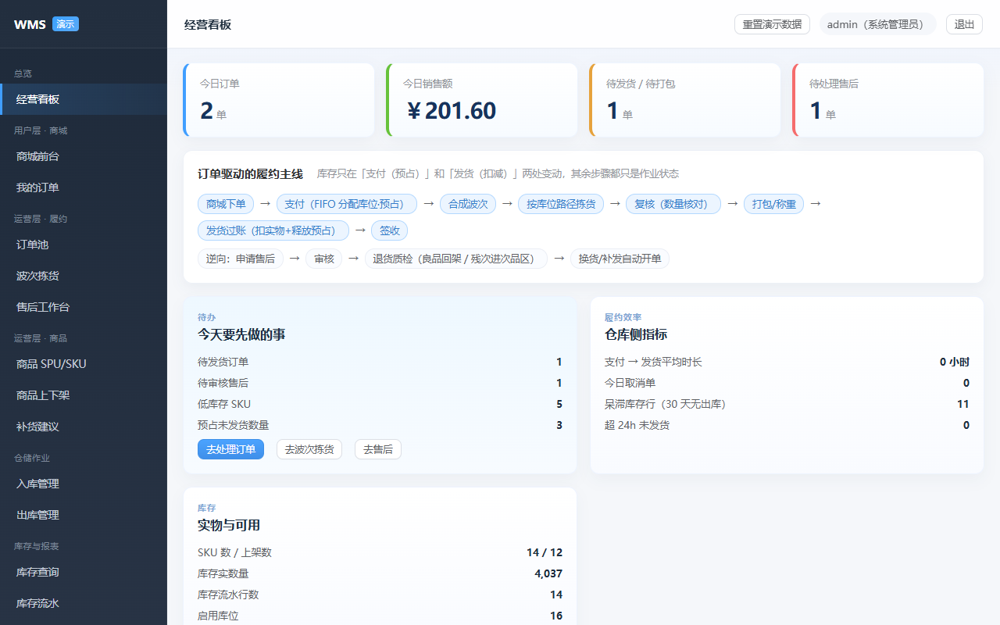

# 电商仓库管理系统（教学案例）

> 这是一个可供教学的电商仓库管理系统，仅供学习参考，用于共同学习。

零依赖就能跑：**Python 标准库 + SQLite**，不需要装任何第三方包；正式方案另附 **MySQL 8** 建表脚本。



## 它是什么

一套「订单驱动」的电商仓配系统，把电商履约的完整链路做成了可运行、可测试的代码：

```
商城下单 → 支付（FIFO 分配库位×批次 + 预占 locked_qty）
        → 按仓拆单（履约单 ec_fulfillment）
        → 波次拣货 → 复核 → 打包 → 发货过账（扣实物 + 释放预占 + 写流水）
        → 签收 → 售后（退货退款 / 仅退款 / 换货 / 补发 + 退货质检）
```

配套的仓储与经营能力：入库 / 出库 / 库存查询 / 流水 / 台账 / 盘点 / 调拨 / 补货建议 / 上下架 / 报表 / 运维。

## 为什么值得作为教学案例

| 教学点 | 在代码里能看到什么 |
|---|---|
| 库存为什么不会超卖 | 条件更新 + 版本号乐观锁 + 预占，`wms_inventory` 与 `wms_inventory_txn` 同事务 |
| 重复点击为什么不重复扣 | `X-Idempotency-Key` + `sys_idempotency` 落库去重，重放返回首次结果 |
| 一个订单为什么要拆单 | 按分配落到的仓库拆成 1..N 张履约单，每仓独立发货，全发完才算「已发货」 |
| 怎么防「买了没发货 / 发空单」 | 12 项一致性校验（`/api/v1/ops/checks`）+ 发货前的状态机与数量校验 |
| 长压测怎么找瓶颈 | `scripts/loadtest.py` + 三套回归脚本；实测暴露过 backlog、keep-alive、单号撞号三个真 bug |
| 权限与数据隔离 | 接口级 `ROUTE_PERM` 强制 + 仓库数据权限（`sys_user_warehouse`） |

## 5 分钟跑起来

**Windows**

```text
双击 demo\启动demo.cmd        → 浏览器打开 http://127.0.0.1:8000  账号 admin / 123456
双击 demo\loadtest.bat        → 跑一轮压测（独立测试库，不动演示数据）
```

**任意系统**

```bash
cd demo
python app.py                 # 默认 127.0.0.1:8000
python app.py --reset         # 重置演示数据
```

演示账号（密码都是 `123456`）：`admin` 全部权限、`ops01` 电商运营、`keeper01/02` 两个仓的仓管、`picker01` 拣货员、`viewer01` 只读。

## 目录

```
demo/                 可运行系统（app.py 后端 + web/ 前端 + tests/ 自测 + scripts/ 压测）
 ├─ app.py            全部业务：订单/库存/仓储/报表/运维（单文件，方便通读）
 ├─ web/              前端源码（原生 JS + SVG 图表，无构建步骤）
 ├─ tests/            4 套自测：主链路 / 权限 / 仓储作业 / 生产化验收
 ├─ scripts/          压测与 MySQL 校验
 └─ PRODUCTION.md     生产化说明：拆单、幂等、限流、分片、故障演练清单
db/schema_mysql.sql   正式库建表脚本（46 表 / 11 外键 / 日汇总 / 任务队列）
doc/                  设计文档章节（Markdown）与架构图
```

## 自测

```bash
cd demo
# 服务跑在 8010 时：
pwsh -File tests/api_smoke.ps1     # 下单→支付→波次→复核→打包→发货→售后→一致性校验
pwsh -File tests/rbac_smoke.ps1    # 权限拒绝、仓库隔离、改权限即时生效
pwsh -File tests/v5_smoke.ps1      # 盘点 / 调拨 / 成本 / 报表 / 批处理
pwsh -File tests/prod_smoke.ps1    # 并发不超卖、幂等、拆单、防空单、队列
```

## 说明

- **仅供学习参考**：代码按「现状」提供，不承诺可用性；用于生产前请自行完成安全加固、压测与数据备份（见 `demo/PRODUCTION.md`）。
- 演示库是 SQLite，首次启动自动建库并灌种子数据；`--reset` 可随时重置。
- 未附开源许可证文件；如需商用或二次分发，请先确认许可范围。
