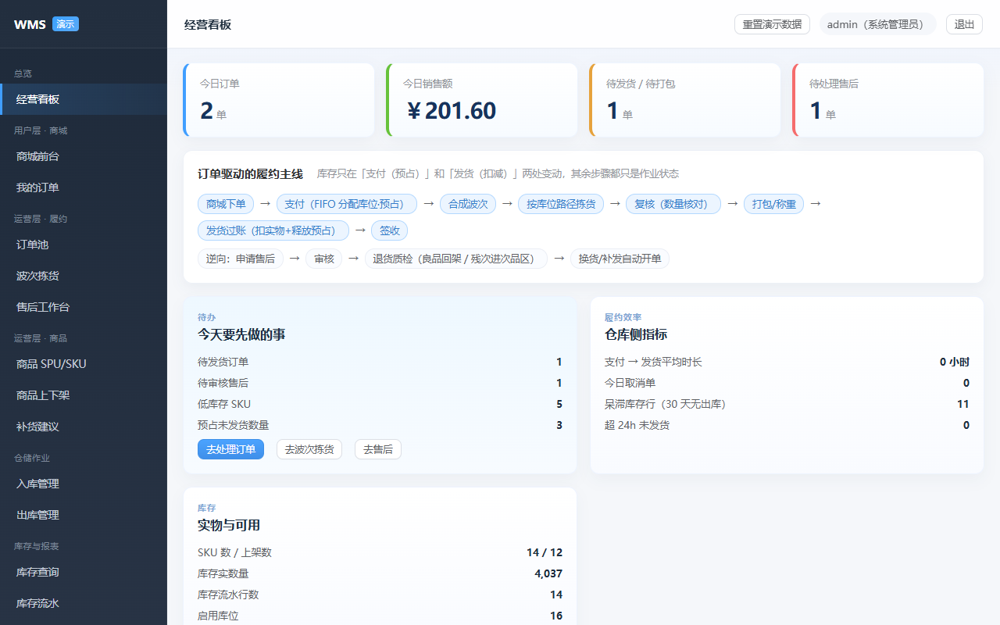
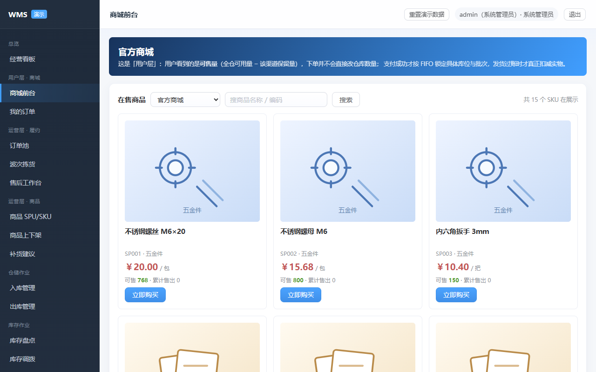
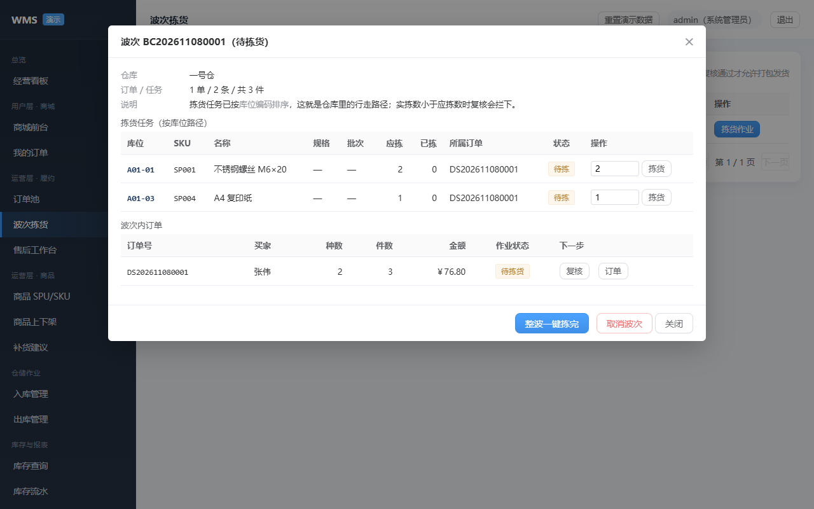
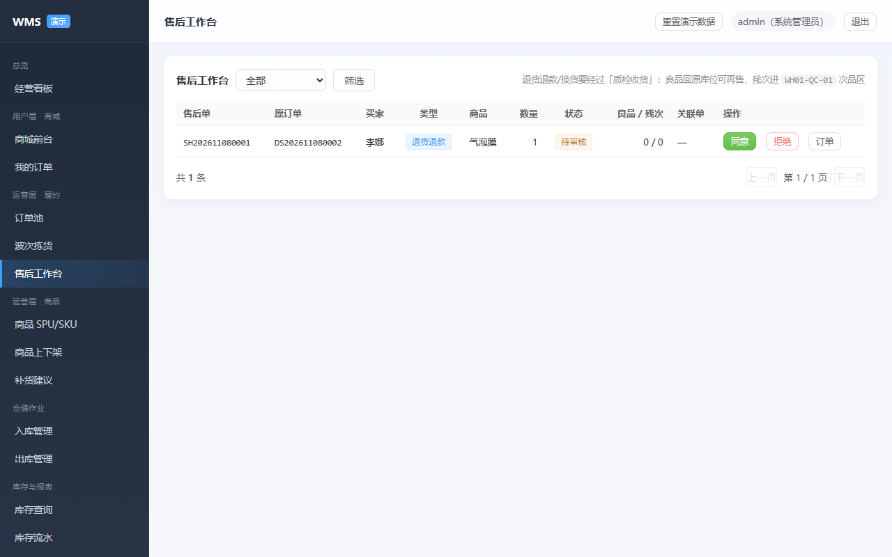
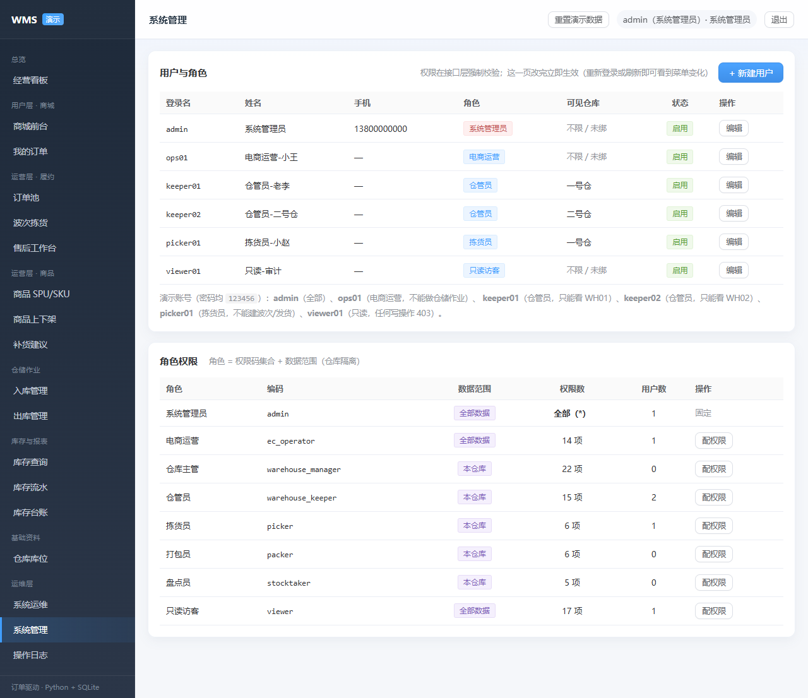
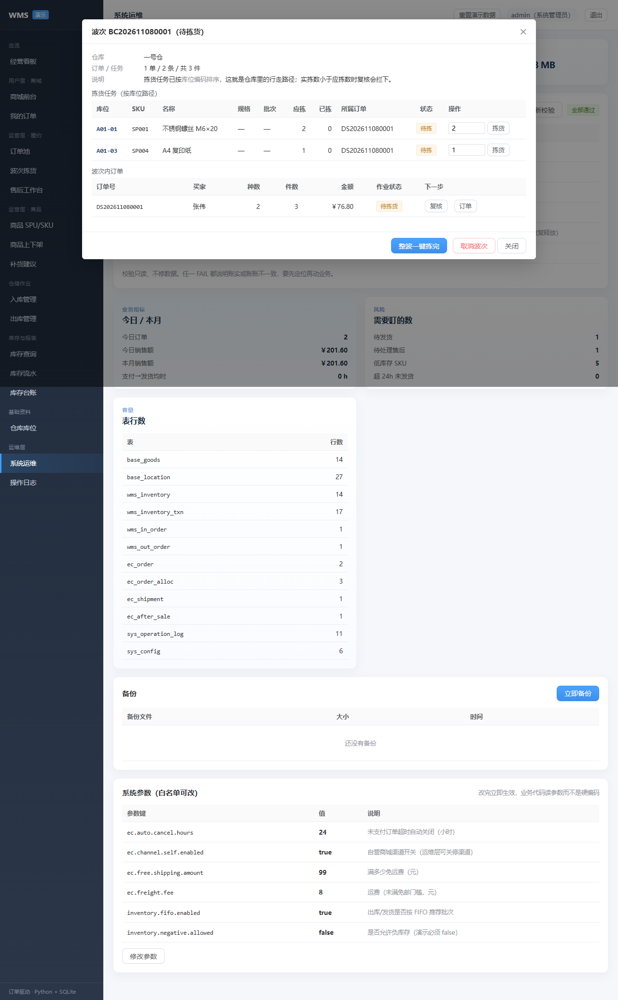

# WMS 本地演示（电商通用版 · 订单驱动）

一个**不需要装任何依赖**的电商仓配系统演示：后端 Python 标准库、数据库 SQLite、前端手写单页应用。
双击 `启动demo.cmd` 即可打开，用来演示「商城下单 → 支付锁库存 → 波次拣货 → 复核 → 打包 → 发货 → 签收 → 售后质检」这条完整链路，
以及支撑它的库存并发控制（预占 / 乐观锁 / 幂等 / 逐笔流水 / 6 项一致性校验）。

> 改造思路与缺漏清单见上一级目录的 **`电商化改进方案_V5.md`**。



## 一、怎么跑

**方式 1（最简单）**：双击 `启动demo.cmd` —— 会自动找 Python、启动服务并打开浏览器。

**方式 2（命令行）**：

```powershell
cd demo
python app.py                 # 默认 http://127.0.0.1:8000
python app.py --port 8080     # 换端口
python app.py --reset         # 重置演示数据（删库重建并重新灌种子数据）
```

**启动器参数**（双击等同于 `启动demo.cmd 8000`）：

```
启动demo.cmd                  # 8000 占用时自动顺延到 8001~8010，并自动打开浏览器
启动demo.cmd 8123             # 指定端口
启动demo.cmd 8123 --no-browser # 指定端口且不自动开浏览器
```

> **为什么这个 .cmd 里一个中文都没有**：cmd.exe 是按当前码页逐行解析批处理的。
> 之前那份脚本是「UTF-8 无 BOM + `chcp 65001`」，解析到中段时码页被切换，后面的中文与换行全部错位，
> 于是出现 `'dmin' 不是内部或外部命令`、`系统找不到指定的路径` 这类乱码命令，Python 探测分支也被截断，服务根本起不来。
> 现在脚本改成了**纯 ASCII + 不切码页 + 用 `%~dp0` 取当前目录**（中文路径不进脚本正文），码页怎么变都不影响。
> 顺带做了三件事：Python 用「真的能跑 `import sys`」来验证（避开 Microsoft Store 的空壳 python.exe）、
> 端口被占用时自动顺延、出错时窗口保留并给出中文外的纯 ASCII 提示。

浏览器打开 <http://127.0.0.1:8000>，账号 **admin / 123456**（也可以访问 `http://127.0.0.1:8000/?autologin=1` 免登录进入）。

> 可选：把 `demo/.env.example` 复制为 `demo/.env` 可覆盖端口、签名密钥、数据库路径、CORS 白名单等。

| 商城前台 | 波次拣货 | 售后质检 |
| --- | --- | --- |
|  |  |  |

| 系统管理（RBAC） | 运维一致性校验 |
| --- | --- |
|  |  |

## 二、5 分钟演示主线（建议按这个顺序点）

1. **商城前台**：商品按 SPU 成组展示，切换「中性笔 0.5mm」的 黑色 / 红色 规格 → 选到红色显示已售罄。
   选黑色、数量 3 → **提交订单并支付**：提示"已进入待发货，库存已按库位预占"，
   该商品**可售量立刻减少**（实物没变，减少的是 `locked_qty`）。
2. **订单池**：勾选 2 张「待发货」→ **合成波次**。提示"2 单 / N 条拣货任务"。
3. **波次拣货**：打开波次，任务已按**库位编码排序**（这就是拣货路径）。
   - 把某条实拣数改小（如应拣 2 填 1）→ 点 **复核** → 被拦下：`复核不通过：… 拣 1/2`（业务码 50001）；
   - 点 **整波一键拣完** → 再复核 → 通过，订单进入「待打包」。
4. **打包 → 发货**：填包裹重量（如 800g）完成打包 → 发货填运单号 → 提示"已发货，扣减 N 件"；
   此时才真正 `quantity−`、`locked_qty−`，并写一条 `biz_type=21` 的库存流水 + 生成发货单。
5. **我的订单**：确认收货 → 订单「已完成」→ 申请售后（退货退款）。
6. **售后工作台**：同意 → **质检收货**（良品 1、残次 1）：
   - 良品回原库位（可再售），残次进 `WH01-QC-01` 次品区（不可售）；
   - 在「库存查询」能看到次品库位多了一条库存，「库存流水」里有 `biz_type=22` 的两条回架流水。
7. **库存盘点**：新建全盘 → 把某行实盘数改成 账面+5、另一行 账面−3 → 保存 → 提交 → 审核：
   库存立刻按差异调整，流水里出现 `biz_type=8`（盘盈）与 `9`（盘亏）。
8. **库存调拨**：把 A01-01 的货调 7 件到 C01-01 → 审核（锁定调出）→ 确认：库存从 A 移到 C，生成 6/7 两条流水，总库存不变。
9. **报表中心**：经营分析（营收折线 + 店铺/分类/仓库条形 + 经营建议）→ 收发存汇总 → 毛利分析 → 动销周转 → 临期预警。
10. **自定义上架**：商品上下架 → 新增上架 → 选「新建商品并上架」→ 填款名/SKU/成本/售价/初始库存 → 保存：一次性生成款、SKU、上架记录并完成初始库存入库，商城立刻能买到。
10. **系统运维**：点「重新校验」→ 6 项硬校验全部 PASS；「立即执行」批处理；点「立即备份」；改「运费」参数立即生效。

**顺手验证这几条拦截**（都应有明确提示，不会写脏数据）：

| 操作 | 期望结果 |
| --- | --- |
| 对已下架商品下单 | `40002 商品已下架` |
| 数量填 99999 再支付 | `50201 支付失败：库存不足`（订单保留在待付款，可补货后重试） |
| 重复点「支付」 | 幂等拦下（`duplicated:true`），不会重复锁库存 |
| 未打包就发货 | `40001 订单已复核，但还没打包` |
| 退超（申请数量 > 已发 − 已申请） | `50201 可售后数量不足` |
| 良品数 + 残次数 ≠ 退货数量 | `40000` 直接拒绝 |

## 三、功能清单

### 用户层（商城前台）

| 页面 | 能力 |
| --- | --- |
| 商城前台 | 商品**缩略图**（分类占位图，也可填自己的图片 URL）、按 SPU 成组、选 SKU 规格、显示**可售量**、立即购买（下单+支付）、已下架/已售罄置灰 |
| 我的订单 | 按状态筛选、详情（明细/分配/运单/包裹）、去支付、取消、确认收货、申请售后 |

### 运营层

| 页面 | 能力 |
| --- | --- |
| 经营看板 | 今日订单/销售额、待发货、待售后、履约时效、低库存、呆滞、预占数量 + 全链路流程图 |
| 订单池 | 全状态筛选、关键词搜索、勾选合成波次、单张处理（取消/打包/发货/代客售后） |
| 波次拣货 | 波次列表、拣货路径（按库位排序）、逐条拣货/整波拣完、复核（短拣拦截）、打包、发货、取消波次 |
| 售后工作台 | 4 类型（仅退款/退货退款/换货/补发）、同意/拒绝、**质检收货（良品/残次）**、关联替换单 |
| 商品 SPU/SKU | SPU 款号 + SKU 规格属性（`{"颜色":"红色"}`）、库存、编辑、**归档删除 / 恢复**（有库存或未完成业务时会被拦下并列出原因） |
| 商品上下架 | **两种上架方式**：① 已有 SKU 只加渠道价；② **新建商品并上架**（款+SKU+规格+图片+售价+初始库存，同事务建款/建SKU/上架/入库过账）；下架即刻停止接单 |
| 补货建议 | 安全库存水位线、缺口、建议补货量、交期、一键生成**采购入库草稿** |
| 库存盘点 | 全盘/抽盘 → 账面快照 → 录实盘 → 提交 → **审核把差异过账**（盘盈 8 / 盘亏 9 流水）；未盘完不允许提交 |
| 库存调拨 | 仓间/库位间：审核即锁定调出量 → 确认时同事务「调出减、调入加」两条流水（6/7）；同库位/超量被拒 |
| 报表中心 | **经营分析**（14 天营收折线、店铺/分类/仓库条形、规则化经营建议）+ 收发存汇总、毛利分析、动销与周转、临期预警 |
| 入库管理 | 建单（多明细、批次、到期日）→ 审核 → 确认入库过账 → 作废 |
| 出库管理 | 建单 → 审核即预占 → 确认出库过账 → 作废释放预占 |
| 库存查询/流水/台账 | 商品×库位×批次、实物/预占/可用、流水变动前后、台账期初+入−出=期末 |
| 仓库库位 | 仓库→库区→货架→库位四级树（含次品区 `WH01-QC`） |

### 运维层

| 页面 | 能力 |
| --- | --- |
| 系统运维 | 健康检查（含 SQLite `integrity_check`）、6 项一致性校验、业务指标、表行数、备份、参数白名单修改 |
| 操作日志 | 登录/建单/审核/过账/拣货/打包/发货/售后/备份全留痕 |

### 权限（RBAC，V4 真正启用）

接口层统一按**权限码**拦截，页面/按钮按同一套权限码渲染，**仓库数据权限**按 `sys_user_warehouse` 过滤列表与写入校验。

| 演示账号 | 密码 | 角色 | 能做什么 / 不能做什么 |
| --- | --- | --- | --- |
| `admin` | 123456 | 系统管理员 | 全部（含系统管理与运维） |
| `ops01` | 123456 | 电商运营 | 订单池/上下架/补货/售后审核；**不能**做仓储作业、看不到入库出库菜单 |
| `keeper01` | 123456 | 仓管员 | 收发货、拣货复核；**只看得到 WH01** 的库存/单据 |
| `keeper02` | 123456 | 仓管员 | 同上，但**只看得到 WH02**（用来验证仓库隔离） |
| `picker01` | 123456 | 拣货员 | 波次拣货；**不能**建波次、不能发货 |
| `viewer01` | 123456 | 只读访客 | 所有查询页面；**任何写操作接口返回 403** |

怎么验证：

1. 用 `picker01` 登录 → 左侧只剩 经营看板/订单池/波次拣货/库存查询/仓库库位（其余菜单被隐藏）；
2. 在「波次拣货」里能拣货，但没有「生成波次」按钮；直接调 `POST /api/v1/ec/waves` 会返回 `40300 无权限：需要「生成/取消波次」`；
3. 用 `keeper01` 和 `keeper02` 分别登录「库存查询」：一个只有 A/B 库区（WH01），一个只有 C 库区（WH02）；
4. 用 `admin` 在「系统管理」里给「拣货员」勾掉「拣货确认」并保存 → `picker01` 刷新后拣货按钮消失、接口也拒绝；
5. 所有登录/建单/审核/发货/改权限都会写进「操作日志」。

> 权限码形如 `ec:order:ship`、`inventory:view`；角色 = 权限码集合 + 数据范围（全部/自定义/本仓库）。
> `admin` 用通配符 `*`，其余角色逐条配置；接口与权限码的映射集中在 `app.py` 的 `ROUTE_PERM`，新增接口时只需补一行。

**真实实现了的技术点**（不是假数据）：

- **过账事务**：改库存 + 写流水 + 改单据状态在同一事务内，任一步失败整单回滚；
- **可用量预占**：支付即按 FIFO 把订单行拆到「库位×批次」并 `locked_qty +=`；
- **乐观锁**：库存表带 `version`，扣减用 `条件更新 + version 比较`，影响行数为 0 判定冲突并重试；
- **幂等**：`X-Idempotency-Key` / `request_id` 唯一 + 流水唯一索引 `(biz_type,biz_id,detail_id)` 三重保险；
- **来源隔离**：电商发货/退货用独立 `biz_type`（21/22），避免与出入库单的自增 ID 撞唯一索引（踩过的坑见方案文档 6.3）；
- **退货质检**：良品回原库位、残次进次品区，两条流水分 `detail_id` 区分；
- **增量迁移**：老库（V2 结构）启动即自动补列、补基线数据（店铺/上下架/补货政策/次品库位），不需要 `--reset`。

**演示范围边界**：单进程、无 Redis/MQ、无平台 API 对接、无电子面单、PDA 未适配、成本核算未做；RBAC 做了权限码 + 仓库数据权限（不含组织架构/审批流/SSO）。
这些在方案文档的「路线图 P1/P2」里。

## 四、目录结构

```
demo/
├── app.py                    # 后端：HTTP 服务 + REST + 建库/种子数据/增量迁移（零依赖）
├── web/                      # 前端（唯一源码）：单页应用，原生 JS
│   ├── index.html            # 布局与菜单（用户层/运营层/仓储/运维层）
│   ├── app.js                # 核心：登录、通用组件、商品/库位/出入库/库存/台账/日志
│   ├── ec.js                 # 电商域：商城前台、订单池、波次拣货、售后、上下架、补货、运维
│   ├── style.css             # 样式（含商城卡片、拣货路径、校验行）
│   └── config.js             # 同源模式留空；独立部署时填后端基址
├── frontend/                 # 独立前端（与 web/ 同步，dist/ 为发布产物）
├── backend/                  # 独立后端（与 app.py 同步，含 CORS 与 /api/v1/health）
├── db/schema_sqlite.sql      # Demo 表结构（含电商扩展表与 V4 作业表）
├── data/wms.db               # SQLite 数据库（删掉会重建并灌演示数据）
├── tests/api_smoke.ps1       # 接口级自测：波次→复核→打包→发货→售后四类型→一致性校验
├── docs/screenshots/         # 界面截图
├── deploy/                   # 防火墙脚本（Linux ufw / Windows）
├── DEPLOY.md                 # 上线准备（环境变量、启动、依赖锁定、检查清单）
├── start_separate.ps1        # 一键起「独立前端 8001 + 独立后端 8000」
├── 启动demo.cmd              # 一键启动（自动找 Python + 打开浏览器）
└── README.md
```

## 五、接口一览（前缀 `/api/v1`，统一响应 `{code,message,data}`）

**用户层**

| 方法 | 路径 | 说明 |
| --- | --- | --- |
| GET | `/shop/goods?shopId=&keyword=` | 商城商品（可售量、规格属性、累计售出） |
| POST | `/shop/orders` | 下单（待付款；价格取服务端上下架价） |
| POST | `/shop/orders/{id}/pay` | 支付（FIFO 分配预占，幂等） |
| GET | `/shop/orders` | 我的订单 |
| POST | `/shop/orders/{id}/cancel` `/receive` | 取消（释放预占）/ 确认收货 |

**运营层**

| 方法 | 路径 | 说明 |
| --- | --- | --- |
| GET/POST | `/ec/orders`、`/ec/orders/{id}` | 订单池 / 详情（明细·分配·包裹·运单·售后·波次） |
| POST | `/ec/orders/{id}/pick` `/pack` `/ship` | 快速拣货 / 打包 / 发货过账（幂等） |
| GET/POST | `/ec/waves`、`/ec/waves/{id}` | 波次列表 / 波次详情（按库位排序的拣货任务） |
| POST | `/ec/waves/{id}/pick` `/review` `/cancel` | 拣货（单条/整波）/ 复核 / 取消波次 |
| GET | `/ec/shipments` | 发货单 |
| GET/POST | `/ec/after-sales` | 售后列表 / 创建（4 类型） |
| POST | `/ec/after-sales/{id}/approve` `/reject` `/receive` | 审核 / 拒绝 / 质检收货（`good_qty`/`bad_qty`） |
| GET/POST/PUT | `/listings`、`/listings/{id}` | 上下架查询 / 新增 / 改价与保留量 |
| GET/PUT/POST | `/replenish/suggestions`、`/replenish/policy`、`/replenish/generate` | 补货建议 / 政策 / 生成采购草稿 |
| GET/POST | `/stocktakes`、`/stocktakes/{id}` + `save` `submit` `audit` `cancel` | 盘点：建单/详情/录实盘/提交/审核过账/作废 |
| GET/POST | `/transfers`、`/transfers/{id}` + `audit` `confirm` `cancel` | 调拨：建单/详情/审核预占/确认过账/作废 |
| GET | `/reports/stock-summary`、`/reports/profit`、`/reports/turnover`、`/reports/expiring` | 收发存汇总 / 毛利 / 动销周转 / 临期预警 |
| GET/POST | `/ops/jobs`、`/ops/jobs/run` | 批处理任务日志 / 立即执行（超时关单、预占与临期扫描） |
| GET/POST/PUT | `/spus`、`/spus/{id}` | 款（SPU）：查询 / 新建 / 改主图 |
| POST | `/catalog/onboard` | 一体化上架：建款+建SKU+渠道价+可选初始库存（同事务） |
| GET | `/reports/trend` `/shop-sales` `/warehouse-stock` `/advice` | 营收趋势 / 店铺与分类营收 / 仓库货值 / 经营建议 |
| GET/POST/PUT | `/goods`、`/goods/{id}` | SKU 查询/新增/修改（含 `spu_id`/`spec_attrs`） |
| GET/POST | `/in-orders`、`/in-orders/{id}` + `audit` `confirm` `cancel` | 入库（采购收货） |
| GET/POST | `/out-orders`、`/out-orders/{id}` + `audit` `confirm` `cancel` | 出库（审核即预占） |
| GET | `/inventory`、`/inventory/txn`、`/reports/ledger` | 库存 / 流水 / 台账 |
| GET | `/stats/summary`、`/logs` | 看板数字 / 操作日志 |

**运维层**

| 方法 | 路径 | 说明 |
| --- | --- | --- |
| GET | `/health` | 免登录存活探针 |
| GET | `/ops/health` | 服务/环境/DB 大小/磁盘/表行数/integrity_check |
| GET | `/ops/metrics` | 订单量、GMV、履约时效、低库存、呆滞、超时未发 |
| GET | `/ops/checks` | 6 项一致性硬校验 |
| GET/POST | `/ops/backups`、`/ops/backup` | 备份列表 / 立即备份 |
| GET/PUT | `/ops/config` | 参数查询 / 白名单修改 |

**系统管理（RBAC）**

| 方法 | 路径 | 说明 |
| --- | --- | --- |
| GET | `/sys/users` | 用户列表（含角色与可见仓库）+ 角色/仓库下拉数据 |
| POST/PUT | `/sys/users`、`/sys/users/{id}` | 新建 / 编辑（改角色、绑仓库、停用、重置密码） |
| GET | `/sys/roles` | 角色列表（权限码、用户数）+ 权限目录 |
| PUT | `/sys/roles/{id}` | 配置角色权限（`admin` 固定全权限，不可改） |
| GET | `/sys/perms` | 权限目录（按模块分组） |

常用错误码：`40002` 商品下架 · `40001` 状态不允许 · `50001` 复核不通过 · `50201` 库存/可售不足 ·
`50202` 并发冲突 · `40901` 重复提交 · `30001` 编码重复 · `40100` 未登录。

## 六、与正式方案的关系

| 项 | 正式方案（技术文档 / `db/schema_mysql.sql`） | 本演示 | 说明 |
| --- | --- | --- | --- |
| 后端 | Spring Boot 3.2 + JDK 17 + MyBatis-Plus | **Python 标准库** | 本机无 Maven/外网，零依赖实现；业务规则与接口契约一致，可作原型 |
| 数据库 | MySQL 8 + Redis 7 | **SQLite**（单文件） | 演示免安装；正式版用 `db/schema_mysql.sql` |
| 前端 | Vue 3 + Element Plus | **原生 JS + 手写 CSS** | 无构建步骤；页面与接口无需改动即可换 Vue |
| 部署 | Docker Compose + Nginx + HTTPS | 单进程 `python app.py` | 见 `DEPLOY.md` |
| 范围 | 40 张表（含 V4 电商域）、RBAC、盘点、调拨、报表 | 核心收发货 + **电商履约 + 售后质检 + 运维** | 正式版需补 P1 项（见方案文档路线图） |

**迁移到正式栈的路径**：① 以 `../db/schema_mysql.sql` 为模型，把本演示新增的电商表（`base_spu`、`ec_*`、`wms_stock_policy`）按 MySQL 方言补齐；
② 后端按第 4/5 章换 Spring Boot，复用本演示的业务规则与状态机；③ 前端换 Vue 3 + Element Plus，接口契约不变。

## 七、常见问题

- **双击后窗口一闪而过 / 浏览器提示「127.0.0.1 拒绝连接」**：说明服务没起来。看那个 cmd 窗口里的第一行错误：
  - `Python 3.8+ not found` → 装 Python 并勾选 "Add python.exe to PATH"（或改 `.cmd` 里的候选路径）；
  - `app.py not found` → 别只拷 `.cmd`，要把整个 demo 目录一起拷；
  - 窗口里出现 `'xxx' 不是内部或外部命令` 的乱码 → 说明脚本被编辑器另存成了 UTF-8 带中文；
    请用仓库里的原版（纯 ASCII），不要用记事本「另存为 UTF-8」改它。
- **端口被占用**：启动器会自动顺延到 8001~8010，窗口标题下方会打印实际 URL；也可以 `启动demo.cmd 8123`。
- **想恢复初始演示数据**：页面右上「重置演示数据」，或 `python app.py --reset`。
- **演示数据造了什么**：14 个 SKU（12 个基础 + 2 个多规格：中性笔红色、瓦楞纸箱 5 号）、2 个 SPU 组多规格、
  2 个仓库共 16 个末级库位 + 1 个次品库位、2 供应商 2 客户、期初库存、1 张已入库单、1 张已出库单、
  2 张电商订单（1 张待发货、1 张已发货并带 1 张待审核售后）、1 个渠道店铺与 14 条上下架。
- **数据存哪**：`data/wms.db`（SQLite），删掉下次启动会重新生成；老库启动会自动增量升级。
- **密码怎么存**：演示用 `sha256(salt+密码)`；正式方案按文档用 BCrypt。
- **接口自测怎么跑**：`pwsh -File tests/api_smoke.ps1`（全链路）、`pwsh -File tests/rbac_smoke.ps1`（权限与仓库隔离）、`pwsh -File tests/v5_smoke.ps1`（盘点/调拨/成本/报表/批处理）、`pwsh -File tests/v5_smoke.ps1`（盘点/调拨/成本/报表/批处理）。服务需在 `8010` 端口，或改脚本里的 `$Base`。
- **权限怎么加**：在 `app.py` 的 `PERM_CATALOG` 加权限码 → 在 `ROUTE_PERM` 给接口挂上 → 前端 `data-perm` 或 `permBtn()` 使用；角色在「系统管理」页勾选即可。


