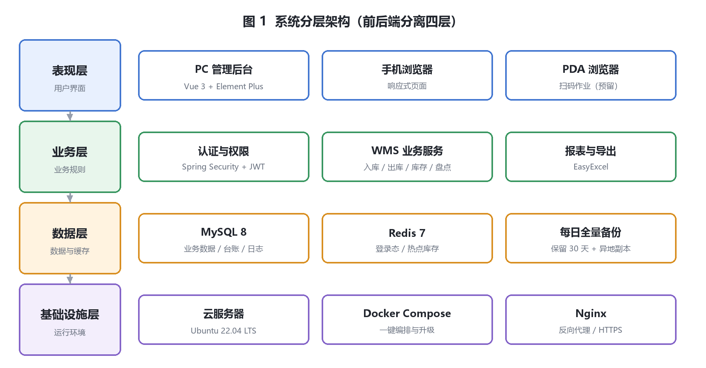
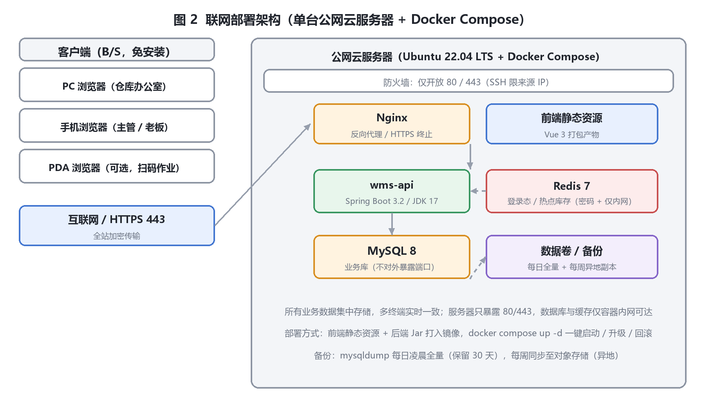
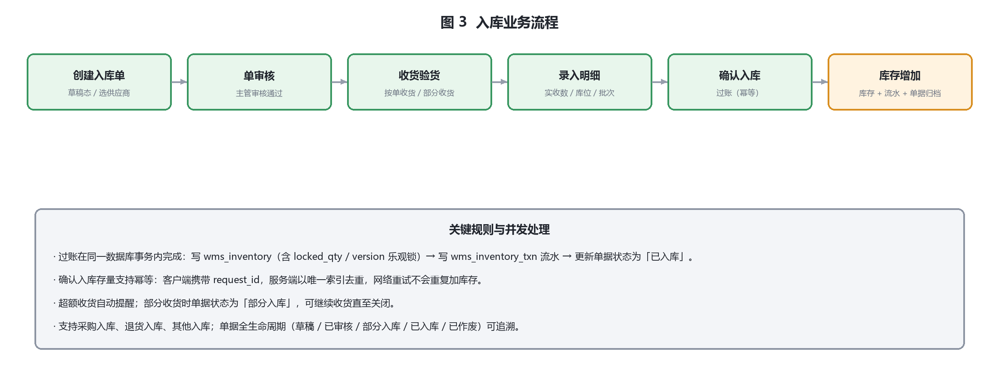
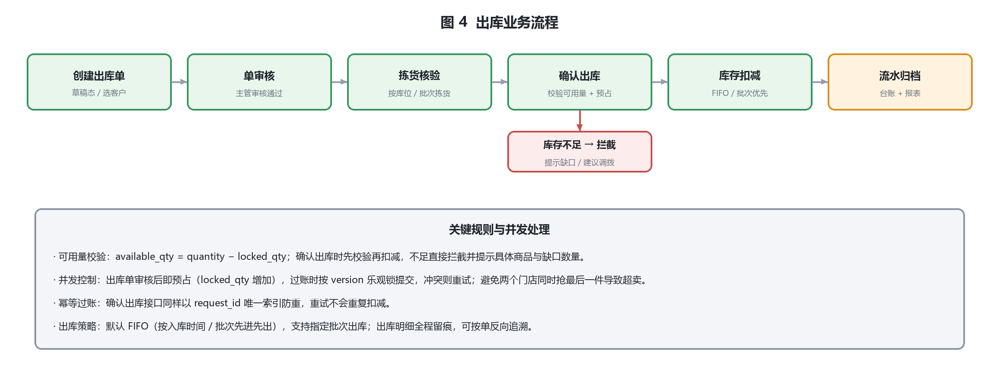

智能仓库管理系统（WMS）

项目方案与技术文档

<b>文档版本：</b>V2.0（修订版）

<b>编制日期：</b>2026 年 9 月

<b>适用场景：</b>中小型仓储联网管理（单仓或多仓，5—50 人使用）

<b>设计原则：</b>功能落地、技术成熟、易扩展、易维护、可验收

修订记录

| 版本 | 日期 | 主要修订内容 |
| --- | --- | --- |
| V1.0 | 2026-09 | 初版：项目概述、四层架构、功能模块、技术栈、5 张核心表、8 个接口、部署与安全方案、3 个月排期 |
| V2.0 | 2026-09 | **补齐可落地的设计细节并修正前后矛盾**，主要变化：① 补齐数据库设计（14 张核心表 + 完整索引与约束 + 建表脚本 `db/schema.sql`）；② 新增**库存并发与一致性设计**（可用量预占 + 乐观锁 + 过账幂等），解决原方案未定义并发控制的问题；③ 补齐接口规范（统一前缀、统一响应、错误码、分页、幂等、限流）与完整接口清单；④ 修正服务器配置与并发人数的矛盾（新增三档选型与容器内存分配）；⑤ 新增**非功能性指标（SLA 基线）**与容量预估；⑥ 新增**验收标准清单、期初数据迁移方案、培训与上线切换方案**；⑦ 新增 5 张架构与流程图；⑧ 排期与人力按实际工作量重排（16 周、约 18.5 人月，原 3 个月 2 人的工期对交付范围偏紧）；⑨ 功能按 P0/P1/P2 与一期/二期/三期分级，明确范围边界 |

目录

{{TOC}}

# 1 项目概述

## 1.1 项目背景

传统人工记账式仓库管理普遍存在库存数据不准、单据流转混乱、多端数据不同步、无法远程监管等问题。本系统采用前后端分离架构与云端部署模式，实现仓库入库、出库、库存、盘点全流程数字化管理，支持多终端通过互联网访问，数据实时同步。

与通用进销存软件相比，本方案针对中小型仓储的三个实际约束做了取舍：**一是作业人员计算机水平有限**，界面字段与流程按现场动线设计，录入操作尽量少、默认值尽量多；**二是没有专职 IT 运维**，采用单台云服务器 + Docker Compose 编排，一键启动与回滚，配套监控告警脚本；**三是并发不高但要求库存绝对准确**，因此在库存并发控制上采用"可用量预占 + 乐观锁 + 过账幂等"的确定性方案（见 4.6）。

## 1.2 建设目标

1. 实现入库、出库、库存、盘点全流程线上化与无纸化，单据全生命周期可追溯。
2. 支持电脑、手机、PDA 等终端通过浏览器访问，数据实时同步，无需安装客户端。
3. 库存数据动态更新且账实一致：每次库存变动同时写库存表与库存流水，支持多维度查询与报表导出。
4. 基于角色实现菜单、按钮、接口、数据四级权限管控，操作全程留痕，满足审计追溯。
5. 采用模块化设计，预留条码、PDA、ERP、电商平台等扩展能力。
6. 交付可验收：功能、性能、安全、文档四类验收标准逐条可判定（见 10.1）。

## 1.3 适用范围与边界

**适用对象**：单仓库或多仓库的中小型生产、商贸企业；日用百货、五金、电子零件、成品仓等通用仓储场景；并发作业人员 5—50 人。

**本期（一期）范围**：基础资料、入库管理、出库管理、库存查询与调拨、库存台账与出入库流水报表、系统管理（RBAC 权限、操作日志、参数配置）。

**明确不在本期范围**（列入二期/三期，避免范围争议）：

| 不包含的内容 | 说明 | 计划期次 |
| --- | --- | --- |
| 库存盘点全流程 | 一期保留数据结构与入口占位，完整盘点流程（全盘/抽盘/差异审批）放二期 | 二期 |
| 批次与保质期管理 | 一期表结构已含批次与到期日字段，管理规则与临期预警放二期 | 二期 |
| 高级报表（周转率、呆滞料、收发存汇总、数据大屏） | 依赖一期数据积累 | 二期 |
| PDA 手持端与条码扫码作业 | 先做设备兼容性验证再实施；一期支持 USB 扫码枪键盘模拟输入 | 三期 |
| RFID、AGV、ERP/电商平台对接、多组织多货主 | 需明确对方系统接口与设备型号后单独评估 | 三期 |
| 历史单据回溯 | 系统上线前的历史出入库单据不还原，以 Excel 归档保留 | 不实施 |
| 财务核算与成本核算 | 本期只做数量管理；字段预留成本价，不做账务处理 | 不实施 |

## 1.4 术语表

| 术语 | 说明 |
| --- | --- |
| SKU / 商品 | 系统中可独立管理的最小存货单位，`base_goods` 一行 |
| 库位 | 仓库→库区→货架→库位四级结构中的最末级，库存挂载的最小粒度，`base_location` 一行 |
| 批次 | 同一商品因入库时间/供应商/生产批号不同形成的区分标识，`batch_no` |
| 可用量 | 可用于出库的数量，`available_qty = quantity − locked_qty` |
| 预占 | 出库单审核后、过账前锁定的数量，计入 `locked_qty` |
| 过账 | 将单据确认生效并改写库存的动作（确认入库/确认出库/盘点确认），必须幂等 |
| 幂等 | 同一请求重复提交只产生一次业务效果，用 `request_id` 唯一索引 + 结果缓存保证 |
| 流水 | 库存变动明细记录，`wms_inventory_txn`，账实核对与台账追溯的依据 |
| FIFO | 先进先出，按入库时间优先出库的批次推荐策略 |
| UAT | 用户验收测试，由客户关键用户按真实业务场景执行 |
| RPO / RTO | 可容忍的数据丢失时间 / 故障后恢复服务的目标时间 |

# 2 总体架构

## 2.1 分层架构

系统采用前后端分离的四层架构，各层职责清晰、可独立开发部署。

| 层级 | 核心职责 | 对应产物 |
| --- | --- | --- |
| 表现层（前端） | 用户界面、数据展示、交互校验、动态路由与按钮权限渲染 | Vue 3 打包产物（静态资源） |
| 业务层（后端） | 业务规则、事务控制、权限校验、库存并发控制、接口输出 | Spring Boot 服务（RESTful API） |
| 数据层 | 结构化数据持久化、热点数据缓存、备份 | MySQL 8、Redis 7 |
| 基础设施层 | 服务器、网络、运行环境 | 云服务器、Ubuntu 22.04、Docker Compose、Nginx |

## 2.2 联网部署架构

所有终端通过浏览器访问集中部署在公网云服务器上的同一套服务，数据全局统一、实时同步；服务器只暴露 80/443，数据库与缓存仅容器内网可达。

访问链路：终端浏览器 → 互联网（HTTPS 443）→ 云服务器防火墙 → Nginx（HTTPS 终止 + 反向代理）→ wms-api（Spring Boot）→ MySQL / Redis；前端静态资源由 Nginx 直接返回，不经过应用服务。

## 2.3 技术选型

| 层次 | 技术 | 版本 | 选型理由 |
| --- | --- | --- | --- |
| 前端框架 | Vue 3 | 3.4+ | 组合式 API、生态成熟、国内资料丰富，招人与维护成本低 |
| UI 组件库 | Element Plus | 2.7+ | 表格/表单/弹窗等管理后台组件齐全，中文文档完善 |
| 前端工程 | Vue Router 4 / Pinia 2 / Axios 1 / Vite | — | 路由与状态管理标准化；Vite 构建速度快，产物可直接由 Nginx 托管 |
| 图表 | ECharts | 5.x | 报表与看板可视化，按需引入控制包体 |
| 后端语言 | Java | JDK 17 | LTS 版本，Spring Boot 3.x 的强制要求 |
| 后端框架 | Spring Boot | 3.2.x | 自动配置、生态完整、企业级稳定 |
| 持久层 | MyBatis-Plus | 3.5.x | SQL 可控（报表统计需要）、条件构造器防注入、分页插件成熟 |
| 安全框架 | Spring Security + JWT | — | 认证授权标准化，便于实现按钮/接口级权限与数据权限拦截 |
| 数据库 | MySQL | 8.0 | 事务与锁机制完善（库存并发依赖行级锁与乐观锁） |
| 缓存 | Redis | 7.x | 登录会话、幂等键、热点库存缓存、限流计数 |
| 报表导出 | EasyExcel / POI | — | 流式写出，1 万行导出不占满内存 |
| 容器 | Docker + Docker Compose | 24+ / 2.20+ | 单机编排简单可靠，一键启动/升级/回滚 |
| 反向代理 | Nginx | 1.25-alpine | HTTPS 终止、静态资源直出、限流兜底 |
| 操作系统 | Ubuntu | 22.04 LTS | 长期支持、云厂商镜像完善、运维资料丰富 |

**未采用的技术与理由**：不引入微服务（团队规模与并发量不需要，运维复杂度反而上升）；不引入消息队列（库存过账要求强一致，同库同事务内完成更简单可靠）；不引入 Elasticsearch（数据量级不需要，报表走 MySQL 索引即可）；不使用物理外键（便于数据导入与历史归档，引用完整性由应用层与校验脚本保证，见 4.1）。

## 2.4 关键设计决策

| 决策点 | 结论 | 理由 |
| --- | --- | --- |
| 架构形态 | 前后端分离的单体后端 | 10—50 人规模下，单体部署与排障最简单；按模块分包为未来拆分预留边界 |
| 库存并发 | 可用量预占 + 版本号乐观锁 + 条件更新 | 库存冲突概率低但后果严重；乐观锁避免长事务锁等待，配合带条件的 `UPDATE` 保证原子扣减（见 4.6） |
| 过账幂等 | 客户端 `request_id` + 唯一索引 + 结果缓存 | 网络抖动、用户重复点击是常态，幂等是数据正确性的底线 |
| 删除策略 | 逻辑删除（`is_deleted`），基础资料以"停用"代替删除 | 可追溯、可恢复，满足审计要求 |
| 数量与金额类型 | 数量 `DECIMAL(18,3)`，金额 `DECIMAL(18,4)` | 支持千克等小数单位与计重商品；禁止用浮点类型 |
| 引用完整性 | 不建物理外键，应用层校验 + 定时校验脚本 | 便于批量导入、历史归档与分表演进 |
| 单据编号 | 前缀 + 日期 + 日期内序列（Redis 原子自增，失败回退数据库序列表） | 编号可读、可追溯、并发安全 |
| 时间与字符集 | 统一 `Asia/Shanghai`，`utf8mb4_general_ci` | 避免跨端时区与中文/emoji 存储问题 |

# 3 功能设计

功能优先级（P0/P1/P2）与期次划分见 9.1，本章描述各模块的功能点与关键业务规则。

## 3.1 基础资料管理

| 功能 | 关键规则 |
| --- | --- |
| 商品档案 | 商品编码全局唯一且不可修改；含名称、分类、规格、单位、条码、成本价（预留）、库存上下限；停用后不可被新单据引用，已被单据引用不可删除 |
| 商品分类 | 支持多级分类，报表可按分类汇总 |
| 仓库与库位 | 仓库→库区→货架→库位四级树；库位编码唯一且建议与现场标识一致（贴码）；含库存的库位不可删除、不可停用 |
| 往来单位 | 供应商与客户档案；已被单据引用不可删除，只能停用 |
| 单位与字典 | 单位、单据类型、状态等字典统一维护，供下拉选择与导入校验使用 |
| 数据导入 | 商品、单位、库位、期初库存通过 Excel 模板导入，先预校验后入库，支持失败行下载（见 10.2） |

## 3.2 入库管理

| 功能 | 关键规则 |
| --- | --- |
| 单据类型 | 采购入库、退货入库、其他入库；类型影响报表统计口径 |
| 单据生命周期 | 草稿 → 已审核 → 部分入库 → 已入库 / 已作废；审核后关键字段（供应商、明细商品）不可修改 |
| 收货与录入 | 支持按单收货、部分收货；超额收货需二次确认并记录原因；明细关联库位、批次、生产日期与到期日 |
| 确认入库（过账） | 同一事务内：库存表增加数量 → 写库存流水 → 更新单据状态；接口幂等，重试不重复加库存 |
| 单据打印 | 浏览器打印模板（入库单、上架单），支持 A4 与针式打印机（可选） |

## 3.3 出库管理

| 功能 | 关键规则 |
| --- | --- |
| 单据类型 | 销售出库、领料出库、调拨出库 |
| 拣货推荐 | 默认 FIFO（按入库时间优先），支持指定批次；系统按库位给出拣货顺序 |
| 可用量校验 | 确认出库时校验 `available_qty ≥ 出库数量`，不足则拒绝并提示具体商品与缺口数量 |
| 预占与释放 | 单据审核后预占（`locked_qty` 增加）；过账时扣减 `quantity` 并释放预占；作废或驳回时释放预占 |
| 确认出库（过账） | 条件更新 + 乐观锁 + `request_id` 幂等；并发冲突自动重试，仍失败提示用户刷新重试 |
| 反向追溯 | 出库明细记录库位、批次与来源，可按商品或批次反查去向 |

## 3.4 库存管理

| 功能 | 关键规则 |
| --- | --- |
| 实时库存查询 | 按商品、仓库、库位、批次多条件组合查询；默认只显示有库存的记录，可切换显示零库存 |
| 库存调拨 | 仓库间/库位间调拨：调出与调入在同一事务内完成，商品总库存不变，生成两条流水 |
| 库存数量调整 | 手工增减必须填写原因并经主管审批，生成调整流水与操作日志（不允许直接改数据库） |
| 库存盘点 | 二期功能：生成盘点单 → 录入实盘数 → 系统计算盈亏 → 审批后调整库存并生成流水 |
| 库存预警 | 二期功能：低于最低库存、高于最高库存、临期到期提醒（阈值存 `sys_config` 与商品字段） |
| 台账与核对 | 提供"期初 + 入库 − 出库 ± 调整 = 期末"的库存台账查询，并可执行一致性校验（见 4.6.4） |

## 3.5 报表统计

| 报表 | 内容与规则 |
| --- | --- |
| 出入库流水报表 | 依据 `wms_inventory_txn` 按时间、商品、往来单位、单据类型筛选；支持汇总与明细两级展示 |
| 库存台账 | 期初、入库、出库、调整、期末结存；可按商品/库位/批次与时间区间查询 |
| 库存现状报表 | 按仓库/库位/分类汇总的库存数量与金额（成本价为预留字段，可选启用） |
| 导出 | 全部报表支持 Excel 导出，导出内容与页面筛选条件一致；单次同步导出上限 2 万行，超限走异步导出 |

## 3.6 系统管理

| 功能 | 关键规则 |
| --- | --- |
| 用户与角色 | 用户可绑定多角色，权限取并集；角色可配置菜单、按钮、接口、数据范围四类权限（见 7.1） |
| 菜单与权限 | 菜单树与权限码统一维护；前端按权限渲染，后端强制校验 |
| 数据权限 | 按全部/自定义仓库/本仓库/本仓库及下级四种范围隔离数据 |
| 操作日志 | 记录登录、新增、修改、删除、审核、过账、作废、导出等操作（字段见 7.3）；不可删除 |
| 参数配置 | 单据编号规则、是否启用 FIFO、库存预警阈值、会话超时时间等 |
| 数据备份与恢复 | 系统内提供手动备份触发与备份记录查看；恢复由运维按 6.5 流程执行 |
