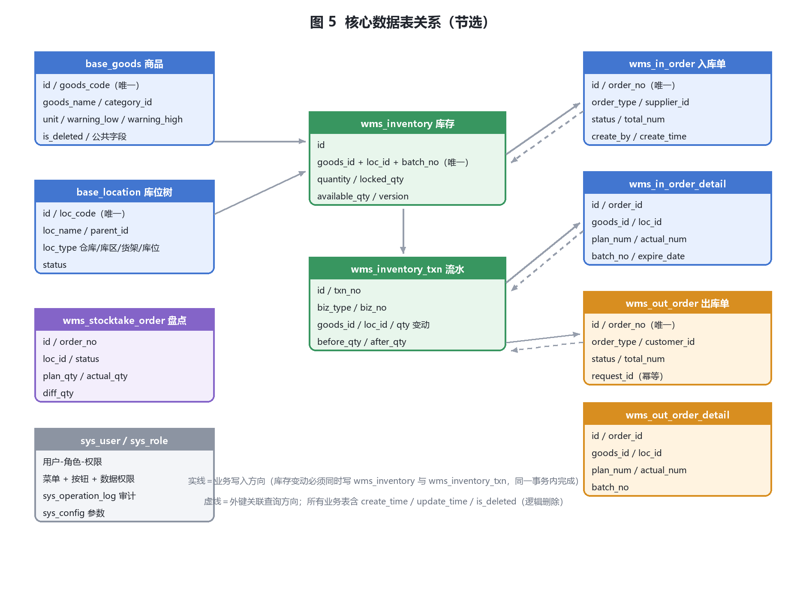

# 4 数据库设计

## 4.1 设计原则

| 原则 | 具体约定 |
| --- | --- |
| 命名规范 | 表名小写下划线；系统权限表前缀 `sys_`，基础资料表前缀 `base_`，业务单据表前缀 `wms_`；主键统一 `id`，外键统一 `<表名单数>_id`（如 `goods_id`、`loc_id`）；布尔语义统一用 `tinyint(1)` 且 1=是 |
| 主键 | `bigint unsigned auto_increment`；不使用 UUID 作主键（避免索引膨胀与页分裂），单据编号等业务标识单独建唯一索引 |
| 公共字段 | 业务表统一含 `create_by`、`create_time`、`update_by`、`update_time`、`is_deleted`；库存表因高频更新只保留 `update_time`（其余见 4.3 说明） |
| 时间与字符集 | 全库 `utf8mb4` / `utf8mb4_general_ci`（支持 emoji 与生僻字）；时间统一 `datetime`，服务器与应用时区 `Asia/Shanghai`；跨时区场景由前端展示层处理 |
| 数量与金额 | 数量 `decimal(18,3)`（支持千克等小数单位），金额与单价 `decimal(18,4)`；**禁止使用 float/double** |
| 逻辑删除 | `is_deleted`：0-未删除 1-已删除；查询自动追加 `is_deleted = 0`；基础资料被单据引用时禁止删除，只能停用（`status=0`） |
| 逻辑删除与唯一索引 | 基础资料编码类唯一索引**不含** `is_deleted`（如 `uk_goods_code (goods_code)`），保证编码永不复用、历史单据可追溯；`sys_user.username` 同理 |
| 外键约束 | **不建物理外键**：便于批量导入、历史归档与后续分表；引用完整性由应用层校验 + 每日校验脚本保证（见 4.6.4） |
| 索引原则 | 高频查询条件建联合索引并遵循最左前缀；联合索引把区分度高的列放前；单表索引不超过 6 个；避免在 `is_deleted` 这种低区分度列上单独建索引 |
| 事务边界 | 一次过账（改库存 + 写流水 + 改单据状态）必须在同一事务内；跨模块操作不做分布式事务，通过幂等与补偿保证最终一致 |
| 归档 | 流水表与日志表按月归档（见 4.8）；业务表数据在线保留 3 年 |

> **与 V1 的表名变更**：`sys_goods` → `base_goods`；`sys_warehouse` → `base_location`（明确其为四级库位树）；新增库存流水表（V1 缺失，导致"库存台账"报表无数据来源）；新增出库单、盘点单、用户角色权限、操作日志等表（V1 第 8 章承诺的 RBAC 与审计缺少表结构支撑）。

## 4.2 表清单

| # | 表名 | 用途 | 关键唯一约束/索引 | 预估量级（3 年） | 期次 |
| --- | --- | --- | --- | --- | --- |
| 1 | `sys_user` | 用户账号 | `uk_username` | 百级 | 一期 |
| 2 | `sys_role` | 角色 | `uk_role_code` | 十级 | 一期 |
| 3 | `sys_permission` | 权限（菜单/按钮/接口） | `uk_perm_code` | 百级 | 一期 |
| 4 | `sys_user_role` | 用户-角色关联 | `uk_user_role (user_id, role_id)` | 百级 | 一期 |
| 5 | `sys_role_permission` | 角色-权限关联 | `uk_role_perm (role_id, perm_id)` | 千级 | 一期 |
| 6 | `sys_user_warehouse` | 用户数据权限（可访问仓库） | `uk_user_wh (user_id, wh_id)` | 百级 | 一期 |
| 7 | `sys_operation_log` | 操作审计日志 | `idx_op_time`、`idx_user_time` | 1,000 万级 | 一期 |
| 8 | `sys_login_log` | 登录日志 | `idx_login_time` | 百万级 | 一期 |
| 9 | `sys_config` | 系统参数 | `uk_config_key` | 十级 | 一期 |
| 10 | `sys_dict` / `sys_dict_item` | 数据字典（单位、单据类型等） | `uk_dict_type+item_value` | 百级 | 一期 |
| 11 | `base_goods_category` | 商品分类（多级） | `uk_category_code` | 百级 | 一期 |
| 12 | `base_goods` | 商品档案 | `uk_goods_code`、`idx_name` | 万级 | 一期 |
| 13 | `base_location` | 仓库→库区→货架→库位树 | `uk_loc_code`、`idx_parent` | 千级 | 一期 |
| 14 | `base_supplier` | 供应商 | `uk_supplier_code` | 千级 | 一期 |
| 15 | `base_customer` | 客户 | `uk_customer_code` | 千级 | 一期 |
| 16 | `wms_inventory` | 实时库存（商品×库位×批次） | `uk_goods_loc_batch`、`idx_loc_goods` | 十万级 | 一期 |
| 17 | `wms_inventory_txn` | **库存流水（台账）** | `uk_biz_detail`、`idx_goods_time`、`idx_loc_time` | 千万级 | 一期 |
| 18 | `wms_in_order` | 入库单主表 | `uk_order_no`、`idx_status_time` | 十万级 | 一期 |
| 19 | `wms_in_order_detail` | 入库单明细 | `idx_order`、`idx_goods` | 百万级 | 一期 |
| 20 | `wms_out_order` | 出库单主表 | `uk_order_no`、`uk_request_id` | 十万级 | 一期 |
| 21 | `wms_out_order_detail` | 出库单明细 | `idx_order`、`idx_goods` | 百万级 | 一期 |
| 22 | `wms_stocktake_order` | 盘点单主表 | `uk_order_no` | 十万级 | 二期 |
| 23 | `wms_stocktake_detail` | 盘点单明细（含盈亏） | `idx_order` | 百万级 | 二期 |
| 24 | `wms_transfer_order` | 调拨单主表 | `uk_order_no` | 万级 | 一期 |
| 25 | `wms_transfer_detail` | 调拨单明细 | `idx_order` | 十万级 | 一期 |

## 4.3 核心表结构

### 4.3.1 商品表 `base_goods`

| 字段 | 类型 | 约束 | 说明 |
| --- | --- | --- | --- |
| `id` | bigint unsigned | 主键、自增 | 商品 ID |
| `goods_code` | varchar(64) | 唯一、非空 | 商品编码（导入与查询主键，不可修改） |
| `goods_name` | varchar(128) | 非空、索引 | 商品名称 |
| `category_id` | bigint unsigned | 非空 | 分类 ID → `base_goods_category.id` |
| `spec` | varchar(128) | — | 规格型号 |
| `unit` | varchar(32) | 非空 | 计量单位（来自字典，支持小数单位） |
| `barcode` | varchar(64) | 索引、可空 | 条码（扫码枪输入用，允许一码多品但需提示） |
| `cost_price` | decimal(18,4) | 默认 0 | 成本价（预留，供库存金额报表使用） |
| `warning_low` | decimal(18,3) | 默认 0 | 最低库存预警值（二期启用） |
| `warning_high` | decimal(18,3) | 默认 0 | 最高库存预警值（二期启用） |
| `status` | tinyint(1) | 非空、默认 1 | 1-启用 0-停用 |
| `remark` | varchar(255) | — | 备注 |
| `create_by` / `create_time` | bigint / datetime | 非空 | 创建人 / 创建时间 |
| `update_by` / `update_time` | bigint / datetime | — | 修改人 / 修改时间 |
| `is_deleted` | tinyint(1) | 非空、默认 0 | 逻辑删除：0-未删除 1-已删除 |

### 4.3.2 库位表 `base_location`

| 字段 | 类型 | 约束 | 说明 |
| --- | --- | --- | --- |
| `id` | bigint unsigned | 主键、自增 | 库位 ID |
| `loc_code` | varchar(64) | 唯一、非空 | 库位编码（建议与现场标识一致，如 `A-01-02-03`） |
| `loc_name` | varchar(128) | 非空 | 名称 |
| `parent_id` | bigint unsigned | 非空、默认 0 | 上级 ID（0 表示根）；索引 `idx_parent` |
| `loc_type` | tinyint | 非空 | 1-仓库 2-库区 3-货架 4-库位 |
| `wh_id` | bigint unsigned | 非空、索引 | 所属仓库 ID（冗余字段，用于数据权限与快速过滤） |
| `status` | tinyint(1) | 非空、默认 1 | 1-启用 0-停用 |
| `create_time` / `update_time` / `is_deleted` | — | — | 公共字段 |

### 4.3.3 库存表 `wms_inventory`（并发核心）

| 字段 | 类型 | 约束 | 说明 |
| --- | --- | --- | --- |
| `id` | bigint unsigned | 主键、自增 | 库存记录 ID |
| `goods_id` | bigint unsigned | 非空 | 商品 ID |
| `loc_id` | bigint unsigned | 非空 | 库位 ID（最末级） |
| `batch_no` | varchar(64) | 非空、默认 '' | 批次号（无批次管理时存空串，避免 NULL 参与唯一索引） |
| `quantity` | decimal(18,3) | 非空、默认 0 | 实物库存数量 |
| `locked_qty` | decimal(18,3) | 非空、默认 0 | 已预占（已审核未过账的出库/调拨） |
| `available_qty` | decimal(18,3) | 非空、默认 0 | 可用量 = `quantity − locked_qty`（冗余存储，写入时同事务维护，便于查询与并发校验） |
| `version` | int unsigned | 非空、默认 0 | 乐观锁版本号，每次库存变动 +1 |
| `expire_date` | date | 可空 | 保质期到期日（二期启用） |
| `in_time` | datetime | 可空 | 最近入库时间（FIFO 推荐依据） |
| `update_time` | datetime | 非空 | 最后变动时间（高频更新表，不设 `is_deleted`，清零记录由归档任务清理） |

**唯一索引 `uk_goods_loc_batch (goods_id, loc_id, batch_no)`**：保证同一商品、同一库位、同一批次只有一行库存，是防止重复插入与并发写入的基础。

### 4.3.4 库存流水表 `wms_inventory_txn`（台账依据）

| 字段 | 类型 | 约束 | 说明 |
| --- | --- | --- | --- |
| `id` | bigint unsigned | 主键、自增 | 流水 ID |
| `txn_no` | varchar(64) | 唯一、非空 | 流水号 |
| `biz_type` | tinyint | 非空 | 1-采购入库 2-退货入库 3-其他入库 4-销售出库 5-领料出库 6-调拨出 7-调拨入 8-盘盈 9-盘亏 10-手工调整 11-期初 |
| `biz_id` | bigint unsigned | 非空 | 来源单据 ID |
| `biz_no` | varchar(64) | 索引 | 来源单据号 |
| `detail_id` | bigint unsigned | 非空、默认 0 | 来源单据明细 ID（盘盈盘亏等无明细时存 0） |
| `goods_id` | bigint unsigned | 非空、索引 | 商品 ID |
| `loc_id` | bigint unsigned | 非空、索引 | 库位 ID |
| `batch_no` | varchar(64) | 非空、默认 '' | 批次号 |
| `change_qty` | decimal(18,3) | 非空 | 变动数量（正数入库、负数出库） |
| `before_qty` | decimal(18,3) | 非空 | 变动前库存 |
| `after_qty` | decimal(18,3) | 非空 | 变动后库存（用于逐笔对账，快速定位差异） |
| `create_by` / `create_time` | bigint / datetime | 非空 | 操作人与时间 |

**唯一索引 `uk_biz_detail (biz_type, biz_id, detail_id)`**：同一单据同一明细只允许一条流水，重复过账在数据库层被拒绝，与 `request_id` 幂等键构成双重保险。

### 4.3.5 入库单 `wms_in_order` / 明细 `wms_in_order_detail`

| 主子 | 字段 | 类型 | 说明 |
| --- | --- | --- | --- |
| 主 | `order_no` | varchar(64) 唯一 | 入库单号（规则见 4.7） |
| 主 | `order_type` | tinyint | 1-采购入库 2-退货入库 3-其他入库 |
| 主 | `supplier_id` | bigint | 供应商 ID（退货入库为原客户 ID 时记入备注） |
| 主 | `wh_id` | bigint | 入库仓库 ID |
| 主 | `status` | tinyint | 0-草稿 1-已审核 2-部分入库 3-已入库 4-已作废 |
| 主 | `total_plan_num` / `total_actual_num` | decimal(18,3) | 计划总量 / 实收总量 |
| 主 | `request_id` | varchar(64) 唯一（可空） | 过账幂等键（首次过账时写入） |
| 主 | `audit_by` / `audit_time` | bigint / datetime | 审核人与审核时间 |
| 主 | `remark` / 公共字段 | — | 备注与创建修改信息 |
| 子 | `order_id` | bigint 索引 | 主表 ID |
| 子 | `goods_id` / `loc_id` | bigint | 商品与库位 |
| 子 | `plan_num` / `actual_num` | decimal(18,3) | 计划数 / 实收数 |
| 子 | `batch_no` / `produce_date` / `expire_date` | varchar / date | 批次与效期（效期二期启用） |
| 子 | `unit` / `remark` / 公共字段 | — | 单位、备注、创建修改信息 |

出库单 `wms_out_order` / `wms_out_order_detail` 结构与入库单对称：`order_type`（1-销售出库 2-领料出库 3-调拨出库）、`customer_id`、`status`（0-草稿 1-已审核 2-拣货中 3-已出库 4-已作废）、`request_id` 幂等键；明细含 `plan_num`、`actual_num`、`loc_id`、`batch_no`，并额外记录本次出库对应的库存版本号用于排查并发冲突。

### 4.3.6 盘点单 `wms_stocktake_order` / 明细 `wms_stocktake_detail`（二期）

主表：`order_no`、`stocktake_type`（1-全盘 2-抽盘）、`wh_id`、`status`（0-草稿 1-盘点中 2-待审核 3-已完成 4-已作废）、`plan_count`、`actual_count`、`diff_count`、审核与公共字段。
明细：`order_id`、`goods_id`、`loc_id`、`batch_no`、`book_qty`（账面数，生成盘点单时快照）、`actual_qty`（实盘数）、`diff_qty`（盈亏，盘盈正、盘亏负）、`diff_reason`。

### 4.3.7 系统与权限表

| 表 | 关键字段 | 说明 |
| --- | --- | --- |
| `sys_user` | `username`(唯一)、`password`(BCrypt)、`real_name`、`phone`、`status`、`pwd_update_time`、`last_login_time` | 用户账号；离职禁用而非删除 |
| `sys_role` | `role_code`(唯一)、`role_name`、`data_scope`(1-全部 2-自定义 3-本仓库 4-本仓库及下级)、`status` | 角色与数据范围类型 |
| `sys_permission` | `perm_code`(唯一)、`perm_name`、`perm_type`(1-菜单 2-按钮 3-接口)、`parent_id`、`path`、`method` | 权限与菜单树 |
| `sys_user_role` / `sys_role_permission` | `user_id+role_id` / `role_id+perm_id`（联合唯一） | 关联表 |
| `sys_user_warehouse` | `user_id`、`wh_id`（联合唯一） | 数据权限：可访问仓库集合 |
| `sys_operation_log` | `user_id`、`op_time`、`ip`、`module`、`op_type`、`biz_id`、`biz_no`、`params_digest`、`result`、`error_msg`、`cost_ms` | 审计日志（字段定义见 7.3） |
| `sys_config` | `config_key`(唯一)、`config_value`、`remark` | 系统参数 |
| `sys_dict` / `sys_dict_item` | `dict_type`+`item_value`（联合唯一） | 字典（单位、单据类型、调整原因等） |

## 4.4 表关系



关系要点：一个商品可在多个库位、多个批次上形成多条库存记录；每条库存记录对应多条库存流水；入库单/出库单与明细是 1:N；明细通过 `goods_id`、`loc_id`、`batch_no` 与库存记录关联；库存的任何变动都必须同时写 `wms_inventory`（现状）与 `wms_inventory_txn`（变动明细），二者在同一事务内完成。

## 4.5 索引与约束设计

| 表 | 索引 | 列 | 用途 |
| --- | --- | --- | --- |
| `base_goods` | 唯一 `uk_goods_code` | `goods_code` | 编码唯一校验、按编码精确查询 |
| `base_goods` | `idx_name` / `idx_barcode` | `goods_name` / `barcode` | 名称模糊查询、扫码定位 |
| `base_location` | 唯一 `uk_loc_code` | `loc_code` | 库位编码唯一 |
| `base_location` | `idx_parent` / `idx_wh` | `parent_id` / `wh_id` | 树形加载、按仓库过滤（数据权限） |
| `wms_inventory` | 唯一 `uk_goods_loc_batch` | `goods_id, loc_id, batch_no` | 防止重复库存行；按商品+库位精确定位 |
| `wms_inventory` | `idx_loc_goods` | `loc_id, goods_id` | 按库位盘库、按库位查库存 |
| `wms_inventory` | `idx_goods_available` | `goods_id, available_qty` | 可用量校验与预警（避免全表扫描） |
| `wms_inventory_txn` | 唯一 `uk_biz_detail` | `biz_type, biz_id, detail_id` | 过账幂等的数据库层保险 |
| `wms_inventory_txn` | `idx_goods_time` | `goods_id, create_time` | 商品流水查询与台账 |
| `wms_inventory_txn` | `idx_loc_time` | `loc_id, create_time` | 库位流水与盘点核对 |
| `wms_in_order` | 唯一 `uk_order_no` / 唯一 `uk_request_id` | `order_no` / `request_id` | 单号唯一 / 幂等 |
| `wms_in_order` | `idx_status_time` | `status, create_time` | 待办列表（待审核、待入库） |
| `wms_in_order_detail` | `idx_order` / `idx_goods` | `order_id` / `goods_id` | 明细加载、按商品反查单据 |
| `wms_out_order` | 唯一 `uk_order_no` / 唯一 `uk_request_id` / `idx_status_time` | 同上 | 同上 |
| `sys_operation_log` | `idx_op_time` / `idx_user_time` | `op_time` / `user_id, op_time` | 审计按时间与人员检索 |

**约束检查清单（每日定时校验）**：① 明细行的 `goods_id`、`loc_id` 必须存在于基础资料；② `wms_inventory` 中 `quantity ≥ 0` 且 `locked_qty ≥ 0` 且 `available_qty = quantity − locked_qty`；③ 同一单据不得重复生成流水；④ 库存数量与流水累加值一致（按库位+批次聚合比对，差异写入校验报告并告警）。

## 4.6 并发与一致性设计（核心）

> V1 方案未定义任何并发控制手段，而系统承诺"多端实时同步 + 库存不足自动拦截"。两人同时出库同一批次时会超卖或覆盖彼此的数量。本节给出确定性方案。

### 4.6.1 三道防线

| 防线 | 机制 | 解决的问题 |
| --- | --- | --- |
| 第一道：可用量预占 | 出库单**审核通过**即预占：`locked_qty += 出库数量`，可用量随之减少；作废/驳回时释放 | 避免"审核通过的订单在过账时才发现没货"；让可用量对所有人可见 |
| 第二道：条件更新 + 乐观锁 | 过账时执行带条件的原子更新（见下方 SQL），影响行数为 0 即为并发冲突，重试 3 次（间隔 50/100/200ms） | 避免两个请求同时扣减导致超卖或覆盖 |
| 第三道：幂等 | 客户端 `request_id` 唯一索引 + Redis 结果缓存 10 分钟 + 流水表 `uk_biz_detail` 唯一索引 | 避免网络重试、重复点击造成重复扣减/重复入库 |

### 4.6.2 关键 SQL（过账时的原子操作）

预占（出库单审核时，逐明细执行）：

```sql
UPDATE wms_inventory
   SET locked_qty    = locked_qty + #{qty},
       available_qty = quantity - (locked_qty + #{qty}),
       version       = version + 1,
       update_time   = NOW()
 WHERE id = #{id}
   AND available_qty >= #{qty}
   AND version = #{version};
-- 影响行数 0 → 并发冲突或可用量不足，回滚整单并提示
```

过账扣减（确认出库时）：先校验并扣减 `quantity`，再释放预占；确认入库时只增加 `quantity`（入库存量不涉及预占，但仍以 `version` 防止与盘点/调整并发覆盖）：

```sql
UPDATE wms_inventory
   SET quantity      = quantity - #{qty},
       locked_qty    = locked_qty - #{qty},
       available_qty = (quantity - #{qty}) - (locked_qty - #{qty}),
       version       = version + 1,
       update_time   = NOW()
 WHERE id = #{id}
   AND quantity >= #{qty}
   AND locked_qty >= #{qty}
   AND version = #{version};
```

库存行不存在时的处理（首次入库/首次上架）：使用 `INSERT ... ON DUPLICATE KEY UPDATE` 依赖唯一索引 `uk_goods_loc_batch` 保证幂等，避免"先查后插"的竞态；并发插入冲突时以唯一键冲突为信号改为 UPDATE 重试。

### 4.6.3 事务边界与锁

- 过账事务范围：`wms_inventory` 更新（逐明细）→ `wms_inventory_txn` 插入（逐明细）→ 单据状态更新 → 幂等键落库。**事务内不做远程调用、不发消息、不写日志文件**，避免长事务。
- 逐明细更新顺序统一按 `goods_id, loc_id` 升序，避免两个并发事务以不同顺序加锁造成死锁。
- 隔离级别 `READ-COMMITTED`（MySQL 默认 `REPEATABLE-READ` 亦可，但需注意间隙锁范围；本方案不依赖间隙锁，故显式设为 RC）。
- 单笔事务明细行数上限 500 行；超过时按 200 行分批提交并记录批次，失败可按单据号重跑（幂等保证安全）。
- 不允许在事务内 `SELECT ... FOR UPDATE` 做长等待：预占校验通过条件更新完成，不显式加悲观锁。

### 4.6.4 一致性与对账

| 检查项 | SQL 口径 | 频率 |
| --- | --- | --- |
| 可用量恒等式 | `SELECT COUNT(*) FROM wms_inventory WHERE available_qty <> quantity - locked_qty` | 每日 |
| 库存非负 | `SELECT COUNT(*) FROM wms_inventory WHERE quantity < 0 OR locked_qty < 0` | 每日 |
| 流水可累加 | 按 `goods_id, loc_id, batch_no` 聚合 `wms_inventory_txn.change_qty` 与 `wms_inventory.quantity` 比对 | 每日 |
| 单据与流水一致 | 已入库/已出库单据的明细行数 = 对应流水条数（排除期初与调整） | 每日 |
| 超时未过账单据 | 审核超过 24 小时仍未过账的单据清单（检查预占是否长期占用） | 每日，输出待办给主管 |

差异处理：校验脚本输出差异清单（含库位、商品、批次、两方数量），由主管确认后在系统中做一次"库存数量调整"（生成调整流水、留痕），**不允许直接改数据库**。

## 4.7 单据编号规则

| 单据 | 规则 | 示例 |
| --- | --- | --- |
| 入库单 | `RK` + `yyyyMMdd` + 4 位日内序列 | `RK202609010001` |
| 出库单 | `CK` + `yyyyMMdd` + 4 位日内序列 | `CK202609010001` |
| 调拨单 | `DB` + `yyyyMMdd` + 3 位 | `DB20260901001` |
| 盘点单 | `PD` + `yyyyMMdd` + 3 位 | `PD20260901001` |
| 库存流水 | `LS` + `yyyyMMdd` + 6 位全局序列 | `LS20260901000001` |

实现：Redis `INCR` 生成日内序列（键 `seq:order:RK:20260901`，TTL 2 天），失败时回退到数据库序列表 `sys_seq`（`SELECT ... FOR UPDATE`）；单号在数据库层建唯一索引兜底，冲突则重取。

## 4.8 数据归档与容量

| 表 | 在线保留 | 归档策略 |
| --- | --- | --- |
| `wms_inventory_txn` | 12 个月 | 超期按月导出至归档表 `wms_inventory_txn_history` 并从在线表删除；3 年数据整体导出至对象存储 |
| `sys_operation_log` / `sys_login_log` | 在线 ≥6 个月 | 超期归档（合规要求 3 年） |
| 单据主表与明细 | 3 年在线 | 超期按年归档 |
| `wms_inventory` 零库存记录 | 活跃 12 个月 | `quantity = 0 AND locked_qty = 0` 且 12 个月未变动记录，由归档任务清理（清理前备份） |

容量预估（单仓、日 800 单、每单 10 行明细）：日增约 2.56 万行、约 12.8 MB，年增约 4.6 GB，3 年约 14 GB；磁盘规划见 8.2。

# 5 接口设计

## 5.1 通用规范

| 规范项 | 约定 |
| --- | --- |
| 统一前缀 | `/api/v1`（**V1 文档中声明的 `/api/wms` 前缀与接口表内路径不一致，本版统一为 `/api/v1`**） |
| 资源命名 | 路径用小写中划线、资源用复数：`/api/v1/in-orders`、`/api/v1/out-orders/{id}/confirm`；**不使用驼峰**（如 `/api/inOrder`） |
| 请求方法 | 查询 `GET`、新增 `POST`、全量修改 `PUT`、部分修改 `PATCH`、删除 `DELETE`；**业务动作（审核、过账、作废）统一用 `POST /{资源}/{id}/{动作}`** |
| 认证 | 除登录、验证码外，全部接口需 `Authorization: Bearer <accessToken>` |
| 统一响应 | `{"code": 200, "message": "操作成功", "data": {...}, "traceId": "..."}`；HTTP 状态码与 `code` 语义一致 |
| 分页 | 请求 `pageNum`（默认 1）、`pageSize`（默认 20，**上限 200**）；响应 `{"list": [], "total": 0, "pageNum": 1, "pageSize": 20}` |
| 时间格式 | `yyyy-MM-dd HH:mm:ss`（`Asia/Shanghai`）；日期 `yyyy-MM-dd` |
| 幂等 | 写接口携带 `X-Idempotency-Key: <UUID>`；服务端 10 分钟内去重并返回首次结果 |
| 防重放 | 关键写接口（过账、审核、作废）额外携带 `X-Timestamp`（毫秒）与 `X-Nonce`；时间偏差 ≤5 分钟，nonce 5 分钟内不重复 |
| 排序字段 | `orderBy` 必须命中白名单（如 `createTime`、`orderNo`），防止 SQL 注入 |
| 限流 | 见 7.2.1；超限返回 429 与 `Retry-After` |
| 金额与数量 | 传输统一用字符串表示小数（`"12.500"`），避免前端浮点精度问题 |
| 版本兼容 | 破坏性变更升级版本号（`/api/v2`）；旧版本保留至少 3 个月并在响应头 `Deprecation` 提示 |

## 5.2 接口清单

| 模块 | 方法 | 路径 | 说明 | 权限码 |
| --- | --- | --- | --- | --- |
| 认证 | POST | `/api/v1/auth/login` | 账号密码登录，返回 accessToken 与 refreshToken | 公开 |
| 认证 | POST | `/api/v1/auth/refresh` | 刷新令牌（令牌旋转，旧 refreshToken 失效） | 公开 |
| 认证 | POST | `/api/v1/auth/logout` | 登出（会话与令牌加入黑名单） | 登录即可 |
| 认证 | GET | `/api/v1/auth/me` | 当前用户信息、角色、权限码、菜单树 | 登录即可 |
| 认证 | PUT | `/api/v1/auth/password` | 修改本人密码 | 登录即可 |
| 用户 | GET | `/api/v1/users` | 用户分页查询 | `sys:user:list` |
| 用户 | POST | `/api/v1/users` | 新增用户（初始密码随机生成） | `sys:user:add` |
| 用户 | PUT | `/api/v1/users/{id}` | 修改用户 | `sys:user:edit` |
| 用户 | PUT | `/api/v1/users/{id}/status` | 启用/停用/重置密码 | `sys:user:edit` |
| 角色 | GET/POST/PUT | `/api/v1/roles`、`/api/v1/roles/{id}` | 角色维护 | `sys:role:*` |
| 角色 | PUT | `/api/v1/roles/{id}/permissions` | 分配权限与数据范围 | `sys:role:assign` |
| 权限 | GET | `/api/v1/permissions/tree` | 权限/菜单树 | `sys:perm:list` |
| 基础资料 | GET/POST/PUT | `/api/v1/goods`、`/api/v1/goods/{id}` | 商品维护（编码唯一校验） | `base:goods:*` |
| 基础资料 | GET | `/api/v1/goods/export` | 商品导出 | `base:goods:export` |
| 基础资料 | GET/POST/PUT | `/api/v1/categories`、`/api/v1/categories/{id}` | 商品分类 | `base:category:*` |
| 基础资料 | GET | `/api/v1/locations/tree` | 仓库库位树 | `base:loc:list` |
| 基础资料 | POST/PUT | `/api/v1/locations`、`/api/v1/locations/{id}` | 仓库/库区/货架/库位维护 | `base:loc:*` |
| 基础资料 | GET/POST/PUT | `/api/v1/suppliers`、`/api/v1/customers` | 供应商与客户 | `base:partner:*` |
| 数据导入 | POST | `/api/v1/imports/{type}/validate` | 预校验（不写库，返回校验报告） | `sys:import:*` |
| 数据导入 | POST | `/api/v1/imports/{type}/commit` | 确认导入（按批次号） | `sys:import:commit` |
| 数据导入 | GET | `/api/v1/imports/{batchId}/errors` | 下载失败明细 | `sys:import:*` |
| 入库 | GET | `/api/v1/in-orders` | 入库单分页查询 | `wms:in:list` |
| 入库 | POST | `/api/v1/in-orders` | 创建入库单（草稿） | `wms:in:add` |
| 入库 | GET | `/api/v1/in-orders/{id}` | 单据详情（含明细） | `wms:in:list` |
| 入库 | PUT | `/api/v1/in-orders/{id}` | 修改草稿单 | `wms:in:edit` |
| 入库 | POST | `/api/v1/in-orders/{id}/audit` | 审核通过 | `wms:in:audit` |
| 入库 | POST | `/api/v1/in-orders/{id}/receive` | 收货登记（支持部分收货） | `wms:in:receive` |
| 入库 | POST | `/api/v1/in-orders/{id}/confirm` | **确认入库（过账，幂等）** | `wms:in:confirm` |
| 入库 | POST | `/api/v1/in-orders/{id}/cancel` | 作废 | `wms:in:cancel` |
| 出库 | GET/POST/PUT | `/api/v1/out-orders`、`/api/v1/out-orders/{id}` | 出库单查询/创建/修改 | `wms:out:*` |
| 出库 | POST | `/api/v1/out-orders/{id}/audit` | 审核（**审核即预占可用量**） | `wms:out:audit` |
| 出库 | GET | `/api/v1/out-orders/{id}/pick-list` | 拣货单（含 FIFO 库位推荐） | `wms:out:pick` |
| 出库 | POST | `/api/v1/out-orders/{id}/confirm` | **确认出库（过账，幂等 + 乐观锁）** | `wms:out:confirm` |
| 出库 | POST | `/api/v1/out-orders/{id}/cancel` | 作废（释放预占） | `wms:out:cancel` |
| 库存 | GET | `/api/v1/inventory` | 实时库存分页查询（商品/仓库/库位/批次） | `wms:inv:list` |
| 库存 | GET | `/api/v1/inventory/summary` | 按商品汇总的库存与可用量 | `wms:inv:list` |
| 库存 | GET | `/api/v1/inventory/{goodsId}/txn` | 指定商品的库存流水 | `wms:inv:txn` |
| 库存 | POST | `/api/v1/inventory/adjust` | 库存数量调整（需审批与原因） | `wms:inv:adjust` |
| 调拨 | POST | `/api/v1/transfers`、`/api/v1/transfers/{id}/confirm` | 调拨单创建与确认（同事务出/入） | `wms:transfer:*` |
| 盘点 | POST | `/api/v1/stocktakes`、`/api/v1/stocktakes/{id}/confirm` | 盘点单生成与确认（二期） | `wms:stocktake:*` |
| 报表 | GET | `/api/v1/reports/txn-flow` | 出入库流水报表 | `report:flow:view` |
| 报表 | GET | `/api/v1/reports/inventory-ledger` | 库存台账（期初/入/出/期末） | `report:ledger:view` |
| 报表 | GET | `/api/v1/reports/inventory-now` | 库存现状与汇总 | `report:inv:view` |
| 报表 | POST | `/api/v1/reports/export` | 异步导出（>2 万行），返回任务号 | `report:export` |
| 报表 | GET | `/api/v1/reports/export/{taskId}` | 查询导出进度与下载链接（24 小时有效） | `report:export` |
| 系统 | GET | `/api/v1/logs/operation`、`/api/v1/logs/login` | 操作与登录日志查询 | `sys:log:list` |
| 系统 | GET/PUT | `/api/v1/configs` | 参数配置 | `sys:config:*` |
| 系统 | GET | `/api/v1/health` | 健康检查（供监控巡检，免鉴权仅内网） | 内网 |

## 5.3 关键接口详述

### 5.3.1 登录

`POST /api/v1/auth/login`

```json
// 请求
{ "username": "zhangsan", "password": "******", "captchaKey": "c1", "captchaCode": "8f2d" }

// 响应
{
  "code": 200, "message": "操作成功", "traceId": "8f1c...",
  "data": {
    "accessToken": "eyJhbGciOiJIUzI1NiIs...",
    "refreshToken": "d9f2...",
    "expiresIn": 7200,
    "user": { "userId": 12, "realName": "张三", "roles": ["warehouse_keeper"] },
    "menus": [ { "path": "/in-order", "name": "入库管理", "perms": ["wms:in:add", "wms:in:confirm"] } ],
    "warehouses": [ { "whId": 3, "whName": "一号仓" } ]
  }
}
```

失败示例：`{"code": 40101, "message": "用户名或密码错误", "data": null}`（连续 5 次失败锁定 15 分钟，返回 `40102`）。

### 5.3.2 库存查询

`GET /api/v1/inventory?goodsCode=SP001&whId=3&locCode=A-01-02-03&batchNo=&onlyAvailable=true&pageNum=1&pageSize=20`

```json
{
  "code": 200, "message": "操作成功",
  "data": {
    "total": 1, "pageNum": 1, "pageSize": 20,
    "list": [
      {
        "goodsId": 1001, "goodsCode": "SP001", "goodsName": "不锈钢螺丝 M6",
        "locId": 55, "locCode": "A-01-02-03", "whName": "一号仓",
        "batchNo": "B20260901", "quantity": "120.000", "lockedQty": "20.000",
        "availableQty": "100.000", "unit": "个", "inTime": "2026-09-01 10:12:00"
      }
    ]
  }
}
```

### 5.3.3 确认出库（并发与幂等的关键接口）

`POST /api/v1/out-orders/{id}/confirm`
请求头：`X-Idempotency-Key: 9d1f...`、`X-Timestamp`、`X-Nonce`

```json
// 请求体（明细可指定实际出库数量与批次；不传批次则按 FIFO 推荐）
{ "lines": [ { "detailId": 3001, "actualNum": "20.000", "locId": 55, "batchNo": "B20260901" } ] }

// 成功
{ "code": 200, "message": "出库成功", "data": { "orderNo": "CK202609010001", "status": 3, "txnCount": 1 } }

// 可用量不足（HTTP 409）
{ "code": 50201, "message": "可用库存不足：不锈钢螺丝 M6 在库位 A-01-02-03 可用 12.000，需出库 20.000",
  "data": { "goodsCode": "SP001", "locCode": "A-01-02-03", "availableQty": "12.000", "requiredQty": "20.000" } }

// 并发冲突且重试失败（HTTP 409）
{ "code": 50202, "message": "库存已被其他操作修改，请刷新后重试", "data": null }

// 重复提交（同一 Idempotency-Key，HTTP 200，返回首次结果）
{ "code": 200, "message": "该单据已出库（重复提交已忽略）", "data": { "orderNo": "CK202609010001", "status": 3 } }
```

服务端处理顺序：幂等键校验 → 单据状态与权限校验 → 逐明细可用量校验（`available_qty ≥ actualNum`）→ 条件更新扣减 + 释放预占（`version` 乐观锁）→ 写库存流水（`uk_biz_detail` 兜底）→ 更新单据状态 → 事务提交 → 幂等结果缓存。任一步失败整单回滚，库存不受影响。

### 5.3.4 确认入库

`POST /api/v1/in-orders/{id}/confirm`，行为与出库对称，差别在于：只增加 `quantity` 与 `available_qty`（不涉及预占）；库存行不存在时用 `INSERT ... ON DUPLICATE KEY UPDATE` 创建；同样要求幂等键与流水唯一索引兜底。

### 5.3.5 库存台账报表

`GET /api/v1/reports/inventory-ledger?beginDate=2026-09-01&endDate=2026-09-30&goodsCode=SP001&locId=55&pageNum=1&pageSize=50`

```json
{
  "code": 200, "message": "操作成功",
  "data": {
    "list": [
      { "goodsCode": "SP001", "goodsName": "不锈钢螺丝 M6", "locCode": "A-01-02-03", "unit": "个",
        "beginQty": "100.000", "inQty": "200.000", "outQty": "180.000", "adjustQty": "-5.000",
        "endQty": "115.000" }
    ],
    "total": 1, "pageNum": 1, "pageSize": 50
  }
}
```

口径：`beginQty` 取区间起始时点前最后一条流水的 `after_qty`（无流水则取期初），`endQty = beginQty + inQty − outQty + adjustQty`，且必须等于 `wms_inventory.quantity`；不符即提示数据异常并给出差异清单。

## 5.4 错误码

| code | HTTP | 含义 | 处理建议 |
| --- | --- | --- | --- |
| 200 | 200 | 成功 | — |
| 40000 | 400 | 参数校验失败 | 提示具体字段 |
| 40001 | 400 | 参数格式错误（日期/数值/枚举） | 提示正确格式 |
| 40100 | 401 | 未登录或令牌缺失 | 跳转登录 |
| 40101 | 401 | 用户名或密码错误 | 提示并计数 |
| 40102 | 401 | 账号锁定（连续失败 5 次） | 提示剩余锁定时间 |
| 40103 | 401 | 令牌过期 | 静默刷新或重新登录 |
| 40300 | 403 | 无权限访问该功能 | 提示联系管理员 |
| 40301 | 403 | 无该仓库数据权限 | 提示数据范围受限 |
| 40400 | 404 | 资源不存在 | 提示并刷新列表 |
| 40900 | 409 | 业务状态不允许该操作（如对已入库单再次确认） | 提示当前状态 |
| 40901 | 409 | **重复提交（幂等键命中）** | 返回首次结果，不重复执行 |
| 42900 | 429 | 请求过于频繁 | 按 `Retry-After` 重试 |
| 50000 | 500 | 系统内部错误 | 记录 traceId 并联系运维 |
| 50001 | 500 | 数据库操作失败 | 同上 |
| 30001 | 409 | 基础资料编码已存在 | 修改编码 |
| 30002 | 409 | 基础资料被单据引用，不可删除 | 改为停用 |
| 40001 | 409 | 入库单状态不允许该操作 | 刷新后重试 |
| 50201 | 409 | **可用库存不足** | 提示缺口数量，建议调拨或补货 |
| 50202 | 409 | **库存并发冲突，重试失败** | 提示刷新后重试 |
| 50301 | 409 | 单据已过账，不可作废 | 需先红冲（二期） |
